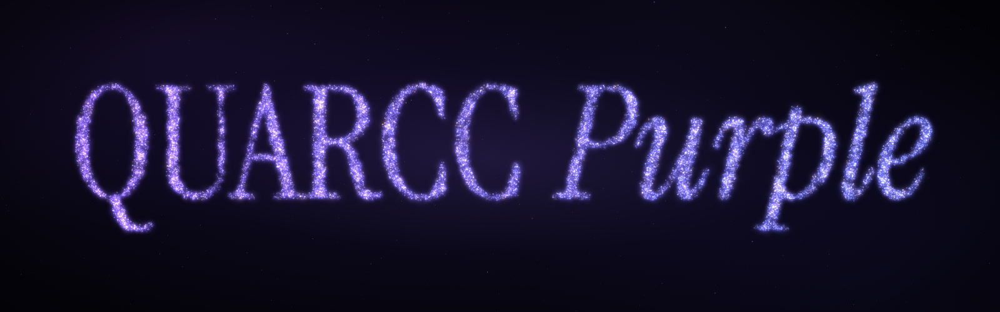
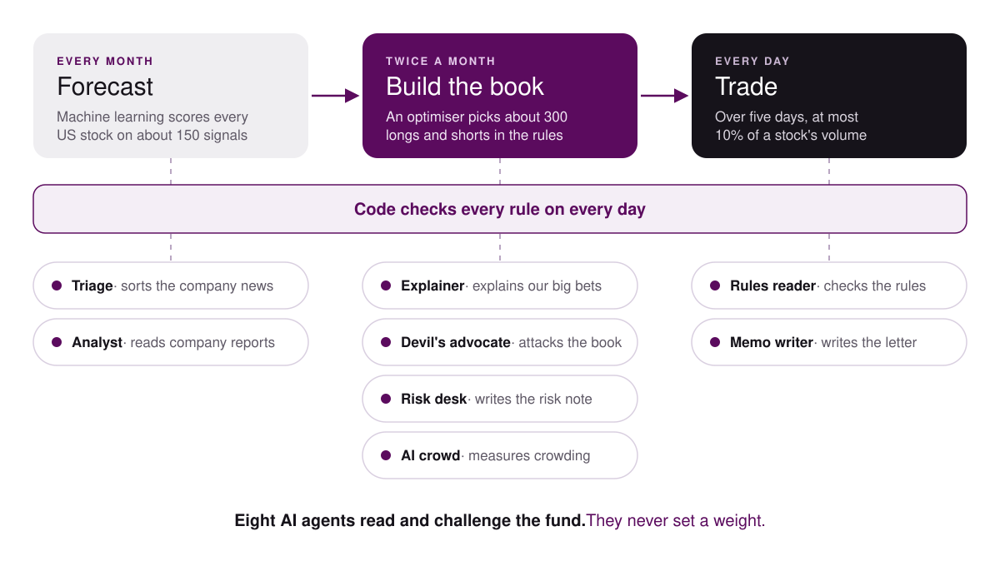

### A market-neutral fund that stays level when AI moves the market

Finalist · McGill-FIAM Asset Management Hackathon 2026

**[Fact sheet](finals/QUARCC_Purple_Fact_Sheet.pdf) · [Deck](finals/QUARCC_Purple_Finals.pdf)**

## The fund

AI is starting to move markets, and machines tend to think alike. QUARCC Purple is built to stay level when they do. It's a $1 billion fund that buys the strongest US companies and shorts the weakest with the same money on both sides, so the market's swings cancel out. In 2022, when the S&P 500 lost 18%, it made 1.3%. Machine learning ranks the stocks, code enforces every rule and eight AI agents read, explain and challenge the book but never trade.

## Results

Less return than the market, with a fraction of the risk. Backtest, January 2021 to August 2026, after all costs.

| | QUARCC Purple | S&P 500 |
|---|---|---|
| Max drawdown | −2.99% | −25.4% |
| Volatility | 3.96% | 15.1% |
| Beta to the S&P 500 | 0.012 | 1.00 |
| Ulcer index | 0.52% | 8.10% |
| Sharpe ratio | 0.91 | 0.70 |
| Sortino ratio | 4.21 | 1.51 |
| Return a year | 7.0% | 13.5% |
| $1bn became | $1.467bn | $2.046bn |

## How it works

Every month a machine-learning model scores every US stock on about 150 signals. An optimiser turns those scores into a balanced book of about 300 longs and shorts, traded slowly over five days, and code checks every rule on every day.

## The AI agents

All eight run on a local model on our own machines and never place a trade. Their records are in [finals/ai/](finals/ai/).

| Agent | What it does |
|---|---|
| Rules reader | Reads the competition rules and checks them against the fund's limits |
| Triage | Sorts our companies' news filings into good, bad or neutral |
| Analyst | Reads the latest reports of our ten biggest longs and shorts |
| Explainer | Explains in plain words why we held our biggest winners and losers |
| Memo writer | Writes the investor letter, with every number checked by code |
| Devil's advocate | Attacks the portfolio and lets the data answer |
| Risk desk | Writes the risk note on the final book, every level set by code |
| AI crowd | Sixty AI investors pick stocks, to measure how crowded our book is |

## Check it yourself

Install [uv](https://docs.astral.sh/uv/) once. These need no data.

| To | Run |
|---|---|
| Check every rule on every day and recompute the headline from the locked results | `uv run run.py` |
| Run the tests | `uv run pytest` |
| Rebuild the deck, byte for byte | `uv run tools/deck/build.py` |

The fund itself reads licensed data from WRDS and the organisers that cannot be shared. With that data in place, these rebuild everything.

| To | Run |
|---|---|
| Prove the code, inputs and 659 outputs match the lock | `uv run fiam verify` |
| Rebuild the whole fund from the raw data, then compare | `uv run fiam rerun` then `uv run fiam compare` |
| Rebuild the website's numbers | `uv run python -m tools.pack` then `uv run python tools/build_site.py` |
| Write the whole repo as one file, MAIN.py | `uv run python tools/build_main.py` |

A rerun on an Apple Silicon Mac matches the lock byte for byte. The deck build needs Node and, once, `pnpm install` and `pnpm exec playwright-core install chromium` in `site/`. On Windows, set `PYTHONUTF8=1` first.

## What is where

| Folder | Holds |
|---|---|
| `finals/` | The fact sheet, the deck, every figure they show and the AI agents' records |
| `fiam/` | The fund in `fiam/vfinal/`, the AI agents in `fiam/agents/` and the shared stock and file helpers |
| `frozen/` | The lock and the fund's locked results, the mandate templates and the agents' frozen inputs |
| `tools/` | The deck builder, the numbers pack, the site data builder, the data tools and the one-file builder |
| `site/` | The website and the film |
| `data/` | Small public series from FRED and Kenneth French |
| `tests/` | The tests |

## Team

| Name | Role | Studies | Links |
|---|---|---|---|
| Nicholas Xydis | AI & Research | Concordia, Computer Science | [LinkedIn](https://www.linkedin.com/in/nicholasxydis/) · [GitHub](https://github.com/NicholasXydis) |
| Yohannah Ilieva | Risk Management | Concordia, Mathematical & Computational Finance | [LinkedIn](https://www.linkedin.com/in/yohannahilieva/) |
| Andrew Koumoudjian | Portfolio Construction | Concordia, Finance | [LinkedIn](https://www.linkedin.com/in/andrewkoumoudjian/) |
| Nicolas Romero | Data & Finance | Concordia, Finance, Mathematics & Statistics | [LinkedIn](https://www.linkedin.com/in/nicolasdavidromero/) |
| Nokto Lapointe | Machine Learning | McGill, Honours Physics & Computer Science | |

## Credits and license

**Data** · FRED, the Kenneth French library, Arcana and Carbon Arc (totals only). The S&P 500 series belongs to S&P Dow Jones Indices.

**License** · The code is under the [MIT License](LICENSE). The data files keep their own terms.
